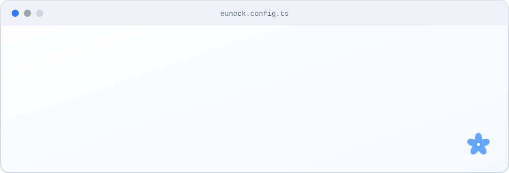

<picture>
  <source media="(prefers-color-scheme: dark)" srcset="assets/header-dark.svg">
  <source media="(prefers-color-scheme: light)" srcset="assets/header-light.svg">
  
</picture>

## Hi, I'm Eunock 👋

**Full Stack Web & Mobile Developer** · Benin 🇧🇯

I build secure, reliable web and mobile applications, from the database and API to the user interface. I care about clean code, continuous learning, and technology that makes a real difference in Benin and across West Africa.

<picture>
  <source media="(prefers-color-scheme: dark)" srcset="assets/terminal-dark.svg">
  <source media="(prefers-color-scheme: light)" srcset="assets/terminal-light.svg">
  
</picture>

## 🛠️ Tech stack

- **Languages**: `JavaScript` `TypeScript` `PHP` `Python`
- **Backend**: `Node.js` `NestJS` `Laravel` `REST APIs` `JWT / OAuth`
- **Frontend & mobile**: `React` `Next.js` `React Native`
- **Databases**: `PostgreSQL` `MySQL` `Neo4j`
- **Tools**: `Linux` `Docker` `Git / GitHub / GitLab` `Jira` `Trello` `Notion`

## 🌱 Currently

- Building the backend of an AI-powered application.
- Learning every day: tech watch and research.

## 📫 Get in touch

- LinkedIn: [Eunock Yvan Aïhounhin](https://www.linkedin.com/in/eunock-yvan-a%C3%AFhounhin-6a2903343/)
- Email: [izumishinishi7@gmail.com](mailto:izumishinishi7@gmail.com)

*Feedback and suggestions on my repositories are always welcome.*
